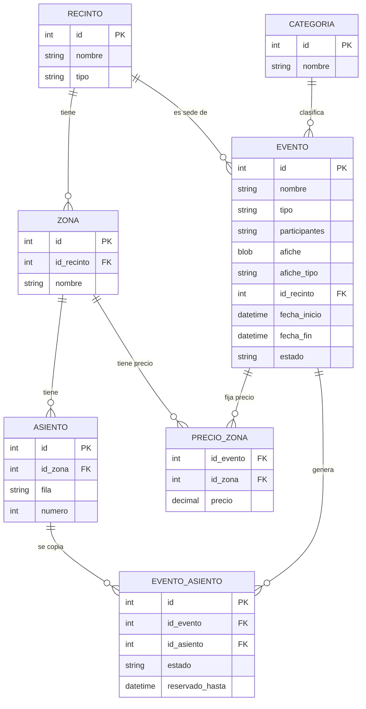
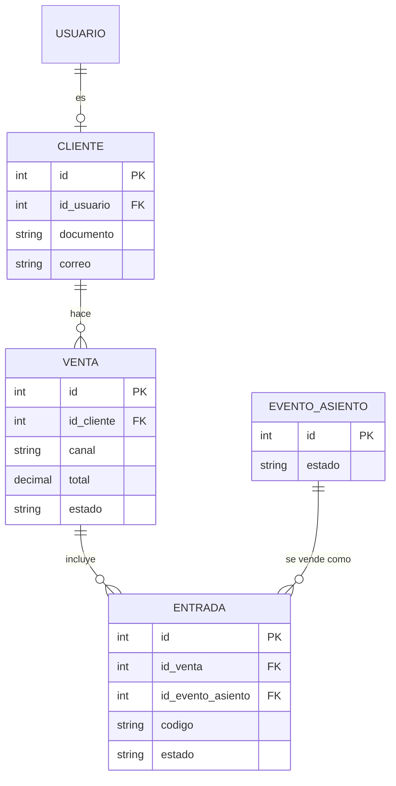
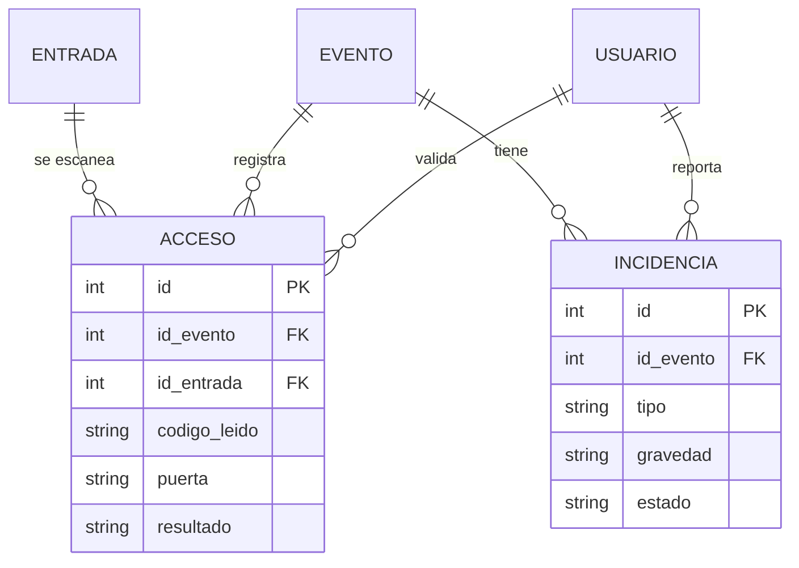
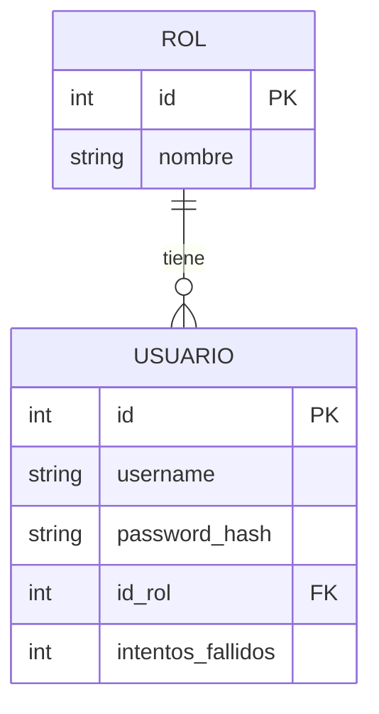

# TICKA — Diagrama de Base de Datos

Los diagramas están en [Mermaid](https://mermaid.js.org/): se ven directamente en GitHub, en VS Code (extensión *Markdown Preview Mermaid Support*) o pegándolos en <https://mermaid.live> para exportar PNG/SVG.

Script asociado: [`01_esquema_ticka.sql`](../sql/01_esquema_ticka.sql)

**Cómo leerlo:** primero el mapa general (todas las tablas en un solo diagrama), después un diagrama más pequeño por cada parte del sistema con sus campos principales.

---

## 1. Mapa general (todas las tablas)

Cada tabla azul muestra sus campos principales (tipo · nombre · llave: **PK** primaria, **FK** foránea, **UK** única). Los recuadros sombreados agrupan las tablas por módulo y rol responsable, y las flechas llevan el verbo de la relación (la flecha gruesa, "se vende como", es la más importante del sistema).

```mermaid
flowchart LR
    subgraph ADM["M6 · Usuarios y seguridad (Administrador)"]
        direction TB
        rol["<table style='border-collapse:collapse;font-size:13px;min-width:210px;border:2px solid rgb(36,113,163);'><tr><th colspan='3' style='background:rgb(36,113,163);color:rgb(255,255,255);text-align:center;padding:5px 10px;font-weight:bold;letter-spacing:.5px;'>ROL</th></tr><tr><td style='padding:3px 9px;color:rgb(16,32,46);background:rgb(234,243,251);border:1px solid rgb(36,113,163);text-align:left;color:rgb(74,106,133);'>int</td><td style='padding:3px 9px;color:rgb(16,32,46);background:rgb(234,243,251);border:1px solid rgb(36,113,163);text-align:left;'>id</td><td style='padding:3px 9px;color:rgb(16,32,46);background:rgb(234,243,251);border:1px solid rgb(36,113,163);text-align:left;text-align:center;width:28px;'><b>PK</b></td></tr><tr><td style='padding:3px 9px;color:rgb(16,32,46);background:rgb(212,230,246);border:1px solid rgb(36,113,163);text-align:left;color:rgb(74,106,133);'>string</td><td style='padding:3px 9px;color:rgb(16,32,46);background:rgb(212,230,246);border:1px solid rgb(36,113,163);text-align:left;'>nombre</td><td style='padding:3px 9px;color:rgb(16,32,46);background:rgb(212,230,246);border:1px solid rgb(36,113,163);text-align:left;text-align:center;width:28px;'><b>UK</b></td></tr></table>"]:::tbl
        usuario["<table style='border-collapse:collapse;font-size:13px;min-width:210px;border:2px solid rgb(36,113,163);'><tr><th colspan='3' style='background:rgb(36,113,163);color:rgb(255,255,255);text-align:center;padding:5px 10px;font-weight:bold;letter-spacing:.5px;'>USUARIO</th></tr><tr><td style='padding:3px 9px;color:rgb(16,32,46);background:rgb(234,243,251);border:1px solid rgb(36,113,163);text-align:left;color:rgb(74,106,133);'>int</td><td style='padding:3px 9px;color:rgb(16,32,46);background:rgb(234,243,251);border:1px solid rgb(36,113,163);text-align:left;'>id</td><td style='padding:3px 9px;color:rgb(16,32,46);background:rgb(234,243,251);border:1px solid rgb(36,113,163);text-align:left;text-align:center;width:28px;'><b>PK</b></td></tr><tr><td style='padding:3px 9px;color:rgb(16,32,46);background:rgb(212,230,246);border:1px solid rgb(36,113,163);text-align:left;color:rgb(74,106,133);'>string</td><td style='padding:3px 9px;color:rgb(16,32,46);background:rgb(212,230,246);border:1px solid rgb(36,113,163);text-align:left;'>username</td><td style='padding:3px 9px;color:rgb(16,32,46);background:rgb(212,230,246);border:1px solid rgb(36,113,163);text-align:left;text-align:center;width:28px;'><b>UK</b></td></tr><tr><td style='padding:3px 9px;color:rgb(16,32,46);background:rgb(234,243,251);border:1px solid rgb(36,113,163);text-align:left;color:rgb(74,106,133);'>string</td><td style='padding:3px 9px;color:rgb(16,32,46);background:rgb(234,243,251);border:1px solid rgb(36,113,163);text-align:left;'>password_hash</td><td style='padding:3px 9px;color:rgb(16,32,46);background:rgb(234,243,251);border:1px solid rgb(36,113,163);text-align:left;text-align:center;width:28px;'>&nbsp;</td></tr><tr><td style='padding:3px 9px;color:rgb(16,32,46);background:rgb(212,230,246);border:1px solid rgb(36,113,163);text-align:left;color:rgb(74,106,133);'>int</td><td style='padding:3px 9px;color:rgb(16,32,46);background:rgb(212,230,246);border:1px solid rgb(36,113,163);text-align:left;'>id_rol</td><td style='padding:3px 9px;color:rgb(16,32,46);background:rgb(212,230,246);border:1px solid rgb(36,113,163);text-align:left;text-align:center;width:28px;'><b>FK</b></td></tr><tr><td style='padding:3px 9px;color:rgb(16,32,46);background:rgb(234,243,251);border:1px solid rgb(36,113,163);text-align:left;color:rgb(74,106,133);'>int</td><td style='padding:3px 9px;color:rgb(16,32,46);background:rgb(234,243,251);border:1px solid rgb(36,113,163);text-align:left;'>intentos_fallidos</td><td style='padding:3px 9px;color:rgb(16,32,46);background:rgb(234,243,251);border:1px solid rgb(36,113,163);text-align:left;text-align:center;width:28px;'>&nbsp;</td></tr></table>"]:::tbl
        rol -->|"tiene"| usuario
    end
    subgraph REC["M2 · Recinto y asientos (Organizador)"]
        direction TB
        recinto["<table style='border-collapse:collapse;font-size:13px;min-width:210px;border:2px solid rgb(36,113,163);'><tr><th colspan='3' style='background:rgb(36,113,163);color:rgb(255,255,255);text-align:center;padding:5px 10px;font-weight:bold;letter-spacing:.5px;'>RECINTO</th></tr><tr><td style='padding:3px 9px;color:rgb(16,32,46);background:rgb(234,243,251);border:1px solid rgb(36,113,163);text-align:left;color:rgb(74,106,133);'>int</td><td style='padding:3px 9px;color:rgb(16,32,46);background:rgb(234,243,251);border:1px solid rgb(36,113,163);text-align:left;'>id</td><td style='padding:3px 9px;color:rgb(16,32,46);background:rgb(234,243,251);border:1px solid rgb(36,113,163);text-align:left;text-align:center;width:28px;'><b>PK</b></td></tr><tr><td style='padding:3px 9px;color:rgb(16,32,46);background:rgb(212,230,246);border:1px solid rgb(36,113,163);text-align:left;color:rgb(74,106,133);'>string</td><td style='padding:3px 9px;color:rgb(16,32,46);background:rgb(212,230,246);border:1px solid rgb(36,113,163);text-align:left;'>nombre</td><td style='padding:3px 9px;color:rgb(16,32,46);background:rgb(212,230,246);border:1px solid rgb(36,113,163);text-align:left;text-align:center;width:28px;'>&nbsp;</td></tr><tr><td style='padding:3px 9px;color:rgb(16,32,46);background:rgb(234,243,251);border:1px solid rgb(36,113,163);text-align:left;color:rgb(74,106,133);'>string</td><td style='padding:3px 9px;color:rgb(16,32,46);background:rgb(234,243,251);border:1px solid rgb(36,113,163);text-align:left;'>tipo</td><td style='padding:3px 9px;color:rgb(16,32,46);background:rgb(234,243,251);border:1px solid rgb(36,113,163);text-align:left;text-align:center;width:28px;'>&nbsp;</td></tr></table>"]:::tbl
        zona["<table style='border-collapse:collapse;font-size:13px;min-width:210px;border:2px solid rgb(36,113,163);'><tr><th colspan='3' style='background:rgb(36,113,163);color:rgb(255,255,255);text-align:center;padding:5px 10px;font-weight:bold;letter-spacing:.5px;'>ZONA</th></tr><tr><td style='padding:3px 9px;color:rgb(16,32,46);background:rgb(234,243,251);border:1px solid rgb(36,113,163);text-align:left;color:rgb(74,106,133);'>int</td><td style='padding:3px 9px;color:rgb(16,32,46);background:rgb(234,243,251);border:1px solid rgb(36,113,163);text-align:left;'>id</td><td style='padding:3px 9px;color:rgb(16,32,46);background:rgb(234,243,251);border:1px solid rgb(36,113,163);text-align:left;text-align:center;width:28px;'><b>PK</b></td></tr><tr><td style='padding:3px 9px;color:rgb(16,32,46);background:rgb(212,230,246);border:1px solid rgb(36,113,163);text-align:left;color:rgb(74,106,133);'>int</td><td style='padding:3px 9px;color:rgb(16,32,46);background:rgb(212,230,246);border:1px solid rgb(36,113,163);text-align:left;'>id_recinto</td><td style='padding:3px 9px;color:rgb(16,32,46);background:rgb(212,230,246);border:1px solid rgb(36,113,163);text-align:left;text-align:center;width:28px;'><b>FK</b></td></tr><tr><td style='padding:3px 9px;color:rgb(16,32,46);background:rgb(234,243,251);border:1px solid rgb(36,113,163);text-align:left;color:rgb(74,106,133);'>string</td><td style='padding:3px 9px;color:rgb(16,32,46);background:rgb(234,243,251);border:1px solid rgb(36,113,163);text-align:left;'>nombre</td><td style='padding:3px 9px;color:rgb(16,32,46);background:rgb(234,243,251);border:1px solid rgb(36,113,163);text-align:left;text-align:center;width:28px;'>&nbsp;</td></tr></table>"]:::tbl
        asiento["<table style='border-collapse:collapse;font-size:13px;min-width:210px;border:2px solid rgb(36,113,163);'><tr><th colspan='3' style='background:rgb(36,113,163);color:rgb(255,255,255);text-align:center;padding:5px 10px;font-weight:bold;letter-spacing:.5px;'>ASIENTO</th></tr><tr><td style='padding:3px 9px;color:rgb(16,32,46);background:rgb(234,243,251);border:1px solid rgb(36,113,163);text-align:left;color:rgb(74,106,133);'>int</td><td style='padding:3px 9px;color:rgb(16,32,46);background:rgb(234,243,251);border:1px solid rgb(36,113,163);text-align:left;'>id</td><td style='padding:3px 9px;color:rgb(16,32,46);background:rgb(234,243,251);border:1px solid rgb(36,113,163);text-align:left;text-align:center;width:28px;'><b>PK</b></td></tr><tr><td style='padding:3px 9px;color:rgb(16,32,46);background:rgb(212,230,246);border:1px solid rgb(36,113,163);text-align:left;color:rgb(74,106,133);'>int</td><td style='padding:3px 9px;color:rgb(16,32,46);background:rgb(212,230,246);border:1px solid rgb(36,113,163);text-align:left;'>id_zona</td><td style='padding:3px 9px;color:rgb(16,32,46);background:rgb(212,230,246);border:1px solid rgb(36,113,163);text-align:left;text-align:center;width:28px;'><b>FK</b></td></tr><tr><td style='padding:3px 9px;color:rgb(16,32,46);background:rgb(234,243,251);border:1px solid rgb(36,113,163);text-align:left;color:rgb(74,106,133);'>string</td><td style='padding:3px 9px;color:rgb(16,32,46);background:rgb(234,243,251);border:1px solid rgb(36,113,163);text-align:left;'>fila</td><td style='padding:3px 9px;color:rgb(16,32,46);background:rgb(234,243,251);border:1px solid rgb(36,113,163);text-align:left;text-align:center;width:28px;'>&nbsp;</td></tr><tr><td style='padding:3px 9px;color:rgb(16,32,46);background:rgb(212,230,246);border:1px solid rgb(36,113,163);text-align:left;color:rgb(74,106,133);'>int</td><td style='padding:3px 9px;color:rgb(16,32,46);background:rgb(212,230,246);border:1px solid rgb(36,113,163);text-align:left;'>numero</td><td style='padding:3px 9px;color:rgb(16,32,46);background:rgb(212,230,246);border:1px solid rgb(36,113,163);text-align:left;text-align:center;width:28px;'>&nbsp;</td></tr></table>"]:::tbl
        recinto -->|"tiene"| zona
        zona -->|"tiene"| asiento
    end
    subgraph EVT["M1 · Eventos (Organizador)"]
        direction TB
        categoria["<table style='border-collapse:collapse;font-size:13px;min-width:210px;border:2px solid rgb(36,113,163);'><tr><th colspan='3' style='background:rgb(36,113,163);color:rgb(255,255,255);text-align:center;padding:5px 10px;font-weight:bold;letter-spacing:.5px;'>CATEGORIA</th></tr><tr><td style='padding:3px 9px;color:rgb(16,32,46);background:rgb(234,243,251);border:1px solid rgb(36,113,163);text-align:left;color:rgb(74,106,133);'>int</td><td style='padding:3px 9px;color:rgb(16,32,46);background:rgb(234,243,251);border:1px solid rgb(36,113,163);text-align:left;'>id</td><td style='padding:3px 9px;color:rgb(16,32,46);background:rgb(234,243,251);border:1px solid rgb(36,113,163);text-align:left;text-align:center;width:28px;'><b>PK</b></td></tr><tr><td style='padding:3px 9px;color:rgb(16,32,46);background:rgb(212,230,246);border:1px solid rgb(36,113,163);text-align:left;color:rgb(74,106,133);'>string</td><td style='padding:3px 9px;color:rgb(16,32,46);background:rgb(212,230,246);border:1px solid rgb(36,113,163);text-align:left;'>nombre</td><td style='padding:3px 9px;color:rgb(16,32,46);background:rgb(212,230,246);border:1px solid rgb(36,113,163);text-align:left;text-align:center;width:28px;'><b>UK</b></td></tr></table>"]:::tbl
        evento["<table style='border-collapse:collapse;font-size:13px;min-width:210px;border:2px solid rgb(36,113,163);'><tr><th colspan='3' style='background:rgb(36,113,163);color:rgb(255,255,255);text-align:center;padding:5px 10px;font-weight:bold;letter-spacing:.5px;'>EVENTO</th></tr><tr><td style='padding:3px 9px;color:rgb(16,32,46);background:rgb(234,243,251);border:1px solid rgb(36,113,163);text-align:left;color:rgb(74,106,133);'>int</td><td style='padding:3px 9px;color:rgb(16,32,46);background:rgb(234,243,251);border:1px solid rgb(36,113,163);text-align:left;'>id</td><td style='padding:3px 9px;color:rgb(16,32,46);background:rgb(234,243,251);border:1px solid rgb(36,113,163);text-align:left;text-align:center;width:28px;'><b>PK</b></td></tr><tr><td style='padding:3px 9px;color:rgb(16,32,46);background:rgb(212,230,246);border:1px solid rgb(36,113,163);text-align:left;color:rgb(74,106,133);'>string</td><td style='padding:3px 9px;color:rgb(16,32,46);background:rgb(212,230,246);border:1px solid rgb(36,113,163);text-align:left;'>nombre</td><td style='padding:3px 9px;color:rgb(16,32,46);background:rgb(212,230,246);border:1px solid rgb(36,113,163);text-align:left;text-align:center;width:28px;'>&nbsp;</td></tr><tr><td style='padding:3px 9px;color:rgb(16,32,46);background:rgb(234,243,251);border:1px solid rgb(36,113,163);text-align:left;color:rgb(74,106,133);'>string</td><td style='padding:3px 9px;color:rgb(16,32,46);background:rgb(234,243,251);border:1px solid rgb(36,113,163);text-align:left;'>tipo</td><td style='padding:3px 9px;color:rgb(16,32,46);background:rgb(234,243,251);border:1px solid rgb(36,113,163);text-align:left;text-align:center;width:28px;'>&nbsp;</td></tr><tr><td style='padding:3px 9px;color:rgb(16,32,46);background:rgb(212,230,246);border:1px solid rgb(36,113,163);text-align:left;color:rgb(74,106,133);'>string</td><td style='padding:3px 9px;color:rgb(16,32,46);background:rgb(212,230,246);border:1px solid rgb(36,113,163);text-align:left;'>participantes</td><td style='padding:3px 9px;color:rgb(16,32,46);background:rgb(212,230,246);border:1px solid rgb(36,113,163);text-align:left;text-align:center;width:28px;'>&nbsp;</td></tr><tr><td style='padding:3px 9px;color:rgb(16,32,46);background:rgb(234,243,251);border:1px solid rgb(36,113,163);text-align:left;color:rgb(74,106,133);'>blob</td><td style='padding:3px 9px;color:rgb(16,32,46);background:rgb(234,243,251);border:1px solid rgb(36,113,163);text-align:left;'>afiche</td><td style='padding:3px 9px;color:rgb(16,32,46);background:rgb(234,243,251);border:1px solid rgb(36,113,163);text-align:left;text-align:center;width:28px;'>&nbsp;</td></tr><tr><td style='padding:3px 9px;color:rgb(16,32,46);background:rgb(212,230,246);border:1px solid rgb(36,113,163);text-align:left;color:rgb(74,106,133);'>string</td><td style='padding:3px 9px;color:rgb(16,32,46);background:rgb(212,230,246);border:1px solid rgb(36,113,163);text-align:left;'>afiche_tipo</td><td style='padding:3px 9px;color:rgb(16,32,46);background:rgb(212,230,246);border:1px solid rgb(36,113,163);text-align:left;text-align:center;width:28px;'>&nbsp;</td></tr><tr><td style='padding:3px 9px;color:rgb(16,32,46);background:rgb(234,243,251);border:1px solid rgb(36,113,163);text-align:left;color:rgb(74,106,133);'>int</td><td style='padding:3px 9px;color:rgb(16,32,46);background:rgb(234,243,251);border:1px solid rgb(36,113,163);text-align:left;'>id_recinto</td><td style='padding:3px 9px;color:rgb(16,32,46);background:rgb(234,243,251);border:1px solid rgb(36,113,163);text-align:left;text-align:center;width:28px;'><b>FK</b></td></tr><tr><td style='padding:3px 9px;color:rgb(16,32,46);background:rgb(212,230,246);border:1px solid rgb(36,113,163);text-align:left;color:rgb(74,106,133);'>int</td><td style='padding:3px 9px;color:rgb(16,32,46);background:rgb(212,230,246);border:1px solid rgb(36,113,163);text-align:left;'>id_categoria</td><td style='padding:3px 9px;color:rgb(16,32,46);background:rgb(212,230,246);border:1px solid rgb(36,113,163);text-align:left;text-align:center;width:28px;'><b>FK</b></td></tr><tr><td style='padding:3px 9px;color:rgb(16,32,46);background:rgb(234,243,251);border:1px solid rgb(36,113,163);text-align:left;color:rgb(74,106,133);'>datetime</td><td style='padding:3px 9px;color:rgb(16,32,46);background:rgb(234,243,251);border:1px solid rgb(36,113,163);text-align:left;'>fecha_inicio</td><td style='padding:3px 9px;color:rgb(16,32,46);background:rgb(234,243,251);border:1px solid rgb(36,113,163);text-align:left;text-align:center;width:28px;'>&nbsp;</td></tr><tr><td style='padding:3px 9px;color:rgb(16,32,46);background:rgb(212,230,246);border:1px solid rgb(36,113,163);text-align:left;color:rgb(74,106,133);'>datetime</td><td style='padding:3px 9px;color:rgb(16,32,46);background:rgb(212,230,246);border:1px solid rgb(36,113,163);text-align:left;'>fecha_fin</td><td style='padding:3px 9px;color:rgb(16,32,46);background:rgb(212,230,246);border:1px solid rgb(36,113,163);text-align:left;text-align:center;width:28px;'>&nbsp;</td></tr><tr><td style='padding:3px 9px;color:rgb(16,32,46);background:rgb(234,243,251);border:1px solid rgb(36,113,163);text-align:left;color:rgb(74,106,133);'>string</td><td style='padding:3px 9px;color:rgb(16,32,46);background:rgb(234,243,251);border:1px solid rgb(36,113,163);text-align:left;'>estado</td><td style='padding:3px 9px;color:rgb(16,32,46);background:rgb(234,243,251);border:1px solid rgb(36,113,163);text-align:left;text-align:center;width:28px;'>&nbsp;</td></tr></table>"]:::tbl
        precio_zona["<table style='border-collapse:collapse;font-size:13px;min-width:210px;border:2px solid rgb(36,113,163);'><tr><th colspan='3' style='background:rgb(36,113,163);color:rgb(255,255,255);text-align:center;padding:5px 10px;font-weight:bold;letter-spacing:.5px;'>PRECIO_ZONA</th></tr><tr><td style='padding:3px 9px;color:rgb(16,32,46);background:rgb(234,243,251);border:1px solid rgb(36,113,163);text-align:left;color:rgb(74,106,133);'>int</td><td style='padding:3px 9px;color:rgb(16,32,46);background:rgb(234,243,251);border:1px solid rgb(36,113,163);text-align:left;'>id</td><td style='padding:3px 9px;color:rgb(16,32,46);background:rgb(234,243,251);border:1px solid rgb(36,113,163);text-align:left;text-align:center;width:28px;'><b>PK</b></td></tr><tr><td style='padding:3px 9px;color:rgb(16,32,46);background:rgb(212,230,246);border:1px solid rgb(36,113,163);text-align:left;color:rgb(74,106,133);'>int</td><td style='padding:3px 9px;color:rgb(16,32,46);background:rgb(212,230,246);border:1px solid rgb(36,113,163);text-align:left;'>id_evento</td><td style='padding:3px 9px;color:rgb(16,32,46);background:rgb(212,230,246);border:1px solid rgb(36,113,163);text-align:left;text-align:center;width:28px;'><b>FK</b></td></tr><tr><td style='padding:3px 9px;color:rgb(16,32,46);background:rgb(234,243,251);border:1px solid rgb(36,113,163);text-align:left;color:rgb(74,106,133);'>int</td><td style='padding:3px 9px;color:rgb(16,32,46);background:rgb(234,243,251);border:1px solid rgb(36,113,163);text-align:left;'>id_zona</td><td style='padding:3px 9px;color:rgb(16,32,46);background:rgb(234,243,251);border:1px solid rgb(36,113,163);text-align:left;text-align:center;width:28px;'><b>FK</b></td></tr><tr><td style='padding:3px 9px;color:rgb(16,32,46);background:rgb(212,230,246);border:1px solid rgb(36,113,163);text-align:left;color:rgb(74,106,133);'>decimal</td><td style='padding:3px 9px;color:rgb(16,32,46);background:rgb(212,230,246);border:1px solid rgb(36,113,163);text-align:left;'>precio</td><td style='padding:3px 9px;color:rgb(16,32,46);background:rgb(212,230,246);border:1px solid rgb(36,113,163);text-align:left;text-align:center;width:28px;'>&nbsp;</td></tr></table>"]:::tbl
        evento_asiento["<table style='border-collapse:collapse;font-size:13px;min-width:210px;border:2px solid rgb(36,113,163);'><tr><th colspan='3' style='background:rgb(36,113,163);color:rgb(255,255,255);text-align:center;padding:5px 10px;font-weight:bold;letter-spacing:.5px;'>EVENTO_ASIENTO</th></tr><tr><td style='padding:3px 9px;color:rgb(16,32,46);background:rgb(234,243,251);border:1px solid rgb(36,113,163);text-align:left;color:rgb(74,106,133);'>int</td><td style='padding:3px 9px;color:rgb(16,32,46);background:rgb(234,243,251);border:1px solid rgb(36,113,163);text-align:left;'>id</td><td style='padding:3px 9px;color:rgb(16,32,46);background:rgb(234,243,251);border:1px solid rgb(36,113,163);text-align:left;text-align:center;width:28px;'><b>PK</b></td></tr><tr><td style='padding:3px 9px;color:rgb(16,32,46);background:rgb(212,230,246);border:1px solid rgb(36,113,163);text-align:left;color:rgb(74,106,133);'>int</td><td style='padding:3px 9px;color:rgb(16,32,46);background:rgb(212,230,246);border:1px solid rgb(36,113,163);text-align:left;'>id_evento</td><td style='padding:3px 9px;color:rgb(16,32,46);background:rgb(212,230,246);border:1px solid rgb(36,113,163);text-align:left;text-align:center;width:28px;'><b>FK</b></td></tr><tr><td style='padding:3px 9px;color:rgb(16,32,46);background:rgb(234,243,251);border:1px solid rgb(36,113,163);text-align:left;color:rgb(74,106,133);'>int</td><td style='padding:3px 9px;color:rgb(16,32,46);background:rgb(234,243,251);border:1px solid rgb(36,113,163);text-align:left;'>id_asiento</td><td style='padding:3px 9px;color:rgb(16,32,46);background:rgb(234,243,251);border:1px solid rgb(36,113,163);text-align:left;text-align:center;width:28px;'><b>FK</b></td></tr><tr><td style='padding:3px 9px;color:rgb(16,32,46);background:rgb(212,230,246);border:1px solid rgb(36,113,163);text-align:left;color:rgb(74,106,133);'>string</td><td style='padding:3px 9px;color:rgb(16,32,46);background:rgb(212,230,246);border:1px solid rgb(36,113,163);text-align:left;'>estado</td><td style='padding:3px 9px;color:rgb(16,32,46);background:rgb(212,230,246);border:1px solid rgb(36,113,163);text-align:left;text-align:center;width:28px;'>&nbsp;</td></tr><tr><td style='padding:3px 9px;color:rgb(16,32,46);background:rgb(234,243,251);border:1px solid rgb(36,113,163);text-align:left;color:rgb(74,106,133);'>datetime</td><td style='padding:3px 9px;color:rgb(16,32,46);background:rgb(234,243,251);border:1px solid rgb(36,113,163);text-align:left;'>reservado_hasta</td><td style='padding:3px 9px;color:rgb(16,32,46);background:rgb(234,243,251);border:1px solid rgb(36,113,163);text-align:left;text-align:center;width:28px;'>&nbsp;</td></tr><tr><td style='padding:3px 9px;color:rgb(16,32,46);background:rgb(212,230,246);border:1px solid rgb(36,113,163);text-align:left;color:rgb(74,106,133);'>int</td><td style='padding:3px 9px;color:rgb(16,32,46);background:rgb(212,230,246);border:1px solid rgb(36,113,163);text-align:left;'>id_cliente_reserva</td><td style='padding:3px 9px;color:rgb(16,32,46);background:rgb(212,230,246);border:1px solid rgb(36,113,163);text-align:left;text-align:center;width:28px;'><b>FK</b></td></tr></table>"]:::tbl
        categoria -->|"clasifica"| evento
        evento -->|"fija precio"| precio_zona
        evento -->|"genera"| evento_asiento
    end
    subgraph CLI["M3 · Portal del cliente (Cliente)"]
        direction TB
        cliente["<table style='border-collapse:collapse;font-size:13px;min-width:210px;border:2px solid rgb(36,113,163);'><tr><th colspan='3' style='background:rgb(36,113,163);color:rgb(255,255,255);text-align:center;padding:5px 10px;font-weight:bold;letter-spacing:.5px;'>CLIENTE</th></tr><tr><td style='padding:3px 9px;color:rgb(16,32,46);background:rgb(234,243,251);border:1px solid rgb(36,113,163);text-align:left;color:rgb(74,106,133);'>int</td><td style='padding:3px 9px;color:rgb(16,32,46);background:rgb(234,243,251);border:1px solid rgb(36,113,163);text-align:left;'>id</td><td style='padding:3px 9px;color:rgb(16,32,46);background:rgb(234,243,251);border:1px solid rgb(36,113,163);text-align:left;text-align:center;width:28px;'><b>PK</b></td></tr><tr><td style='padding:3px 9px;color:rgb(16,32,46);background:rgb(212,230,246);border:1px solid rgb(36,113,163);text-align:left;color:rgb(74,106,133);'>int</td><td style='padding:3px 9px;color:rgb(16,32,46);background:rgb(212,230,246);border:1px solid rgb(36,113,163);text-align:left;'>id_usuario</td><td style='padding:3px 9px;color:rgb(16,32,46);background:rgb(212,230,246);border:1px solid rgb(36,113,163);text-align:left;text-align:center;width:28px;'><b>FK</b></td></tr><tr><td style='padding:3px 9px;color:rgb(16,32,46);background:rgb(234,243,251);border:1px solid rgb(36,113,163);text-align:left;color:rgb(74,106,133);'>string</td><td style='padding:3px 9px;color:rgb(16,32,46);background:rgb(234,243,251);border:1px solid rgb(36,113,163);text-align:left;'>documento</td><td style='padding:3px 9px;color:rgb(16,32,46);background:rgb(234,243,251);border:1px solid rgb(36,113,163);text-align:left;text-align:center;width:28px;'><b>UK</b></td></tr><tr><td style='padding:3px 9px;color:rgb(16,32,46);background:rgb(212,230,246);border:1px solid rgb(36,113,163);text-align:left;color:rgb(74,106,133);'>string</td><td style='padding:3px 9px;color:rgb(16,32,46);background:rgb(212,230,246);border:1px solid rgb(36,113,163);text-align:left;'>correo</td><td style='padding:3px 9px;color:rgb(16,32,46);background:rgb(212,230,246);border:1px solid rgb(36,113,163);text-align:left;text-align:center;width:28px;'><b>UK</b></td></tr></table>"]:::tbl
        venta["<table style='border-collapse:collapse;font-size:13px;min-width:210px;border:2px solid rgb(36,113,163);'><tr><th colspan='3' style='background:rgb(36,113,163);color:rgb(255,255,255);text-align:center;padding:5px 10px;font-weight:bold;letter-spacing:.5px;'>VENTA</th></tr><tr><td style='padding:3px 9px;color:rgb(16,32,46);background:rgb(234,243,251);border:1px solid rgb(36,113,163);text-align:left;color:rgb(74,106,133);'>int</td><td style='padding:3px 9px;color:rgb(16,32,46);background:rgb(234,243,251);border:1px solid rgb(36,113,163);text-align:left;'>id</td><td style='padding:3px 9px;color:rgb(16,32,46);background:rgb(234,243,251);border:1px solid rgb(36,113,163);text-align:left;text-align:center;width:28px;'><b>PK</b></td></tr><tr><td style='padding:3px 9px;color:rgb(16,32,46);background:rgb(212,230,246);border:1px solid rgb(36,113,163);text-align:left;color:rgb(74,106,133);'>int</td><td style='padding:3px 9px;color:rgb(16,32,46);background:rgb(212,230,246);border:1px solid rgb(36,113,163);text-align:left;'>id_cliente</td><td style='padding:3px 9px;color:rgb(16,32,46);background:rgb(212,230,246);border:1px solid rgb(36,113,163);text-align:left;text-align:center;width:28px;'><b>FK</b></td></tr><tr><td style='padding:3px 9px;color:rgb(16,32,46);background:rgb(234,243,251);border:1px solid rgb(36,113,163);text-align:left;color:rgb(74,106,133);'>string</td><td style='padding:3px 9px;color:rgb(16,32,46);background:rgb(234,243,251);border:1px solid rgb(36,113,163);text-align:left;'>canal</td><td style='padding:3px 9px;color:rgb(16,32,46);background:rgb(234,243,251);border:1px solid rgb(36,113,163);text-align:left;text-align:center;width:28px;'>&nbsp;</td></tr><tr><td style='padding:3px 9px;color:rgb(16,32,46);background:rgb(212,230,246);border:1px solid rgb(36,113,163);text-align:left;color:rgb(74,106,133);'>decimal</td><td style='padding:3px 9px;color:rgb(16,32,46);background:rgb(212,230,246);border:1px solid rgb(36,113,163);text-align:left;'>total</td><td style='padding:3px 9px;color:rgb(16,32,46);background:rgb(212,230,246);border:1px solid rgb(36,113,163);text-align:left;text-align:center;width:28px;'>&nbsp;</td></tr><tr><td style='padding:3px 9px;color:rgb(16,32,46);background:rgb(234,243,251);border:1px solid rgb(36,113,163);text-align:left;color:rgb(74,106,133);'>string</td><td style='padding:3px 9px;color:rgb(16,32,46);background:rgb(234,243,251);border:1px solid rgb(36,113,163);text-align:left;'>estado</td><td style='padding:3px 9px;color:rgb(16,32,46);background:rgb(234,243,251);border:1px solid rgb(36,113,163);text-align:left;text-align:center;width:28px;'>&nbsp;</td></tr></table>"]:::tbl
        entrada["<table style='border-collapse:collapse;font-size:13px;min-width:210px;border:2px solid rgb(36,113,163);'><tr><th colspan='3' style='background:rgb(36,113,163);color:rgb(255,255,255);text-align:center;padding:5px 10px;font-weight:bold;letter-spacing:.5px;'>ENTRADA</th></tr><tr><td style='padding:3px 9px;color:rgb(16,32,46);background:rgb(234,243,251);border:1px solid rgb(36,113,163);text-align:left;color:rgb(74,106,133);'>int</td><td style='padding:3px 9px;color:rgb(16,32,46);background:rgb(234,243,251);border:1px solid rgb(36,113,163);text-align:left;'>id</td><td style='padding:3px 9px;color:rgb(16,32,46);background:rgb(234,243,251);border:1px solid rgb(36,113,163);text-align:left;text-align:center;width:28px;'><b>PK</b></td></tr><tr><td style='padding:3px 9px;color:rgb(16,32,46);background:rgb(212,230,246);border:1px solid rgb(36,113,163);text-align:left;color:rgb(74,106,133);'>int</td><td style='padding:3px 9px;color:rgb(16,32,46);background:rgb(212,230,246);border:1px solid rgb(36,113,163);text-align:left;'>id_venta</td><td style='padding:3px 9px;color:rgb(16,32,46);background:rgb(212,230,246);border:1px solid rgb(36,113,163);text-align:left;text-align:center;width:28px;'><b>FK</b></td></tr><tr><td style='padding:3px 9px;color:rgb(16,32,46);background:rgb(234,243,251);border:1px solid rgb(36,113,163);text-align:left;color:rgb(74,106,133);'>int</td><td style='padding:3px 9px;color:rgb(16,32,46);background:rgb(234,243,251);border:1px solid rgb(36,113,163);text-align:left;'>id_evento_asiento</td><td style='padding:3px 9px;color:rgb(16,32,46);background:rgb(234,243,251);border:1px solid rgb(36,113,163);text-align:left;text-align:center;width:28px;'><b>FK</b></td></tr><tr><td style='padding:3px 9px;color:rgb(16,32,46);background:rgb(212,230,246);border:1px solid rgb(36,113,163);text-align:left;color:rgb(74,106,133);'>string</td><td style='padding:3px 9px;color:rgb(16,32,46);background:rgb(212,230,246);border:1px solid rgb(36,113,163);text-align:left;'>codigo</td><td style='padding:3px 9px;color:rgb(16,32,46);background:rgb(212,230,246);border:1px solid rgb(36,113,163);text-align:left;text-align:center;width:28px;'><b>UK</b></td></tr><tr><td style='padding:3px 9px;color:rgb(16,32,46);background:rgb(234,243,251);border:1px solid rgb(36,113,163);text-align:left;color:rgb(74,106,133);'>string</td><td style='padding:3px 9px;color:rgb(16,32,46);background:rgb(234,243,251);border:1px solid rgb(36,113,163);text-align:left;'>estado</td><td style='padding:3px 9px;color:rgb(16,32,46);background:rgb(234,243,251);border:1px solid rgb(36,113,163);text-align:left;text-align:center;width:28px;'>&nbsp;</td></tr></table>"]:::tbl
        cliente -->|"hace"| venta
        venta -->|"incluye"| entrada
    end
    subgraph ACC["M4 y M5 · Puerta (Control de acceso)"]
        direction TB
        acceso["<table style='border-collapse:collapse;font-size:13px;min-width:210px;border:2px solid rgb(36,113,163);'><tr><th colspan='3' style='background:rgb(36,113,163);color:rgb(255,255,255);text-align:center;padding:5px 10px;font-weight:bold;letter-spacing:.5px;'>ACCESO</th></tr><tr><td style='padding:3px 9px;color:rgb(16,32,46);background:rgb(234,243,251);border:1px solid rgb(36,113,163);text-align:left;color:rgb(74,106,133);'>int</td><td style='padding:3px 9px;color:rgb(16,32,46);background:rgb(234,243,251);border:1px solid rgb(36,113,163);text-align:left;'>id</td><td style='padding:3px 9px;color:rgb(16,32,46);background:rgb(234,243,251);border:1px solid rgb(36,113,163);text-align:left;text-align:center;width:28px;'><b>PK</b></td></tr><tr><td style='padding:3px 9px;color:rgb(16,32,46);background:rgb(212,230,246);border:1px solid rgb(36,113,163);text-align:left;color:rgb(74,106,133);'>int</td><td style='padding:3px 9px;color:rgb(16,32,46);background:rgb(212,230,246);border:1px solid rgb(36,113,163);text-align:left;'>id_evento</td><td style='padding:3px 9px;color:rgb(16,32,46);background:rgb(212,230,246);border:1px solid rgb(36,113,163);text-align:left;text-align:center;width:28px;'><b>FK</b></td></tr><tr><td style='padding:3px 9px;color:rgb(16,32,46);background:rgb(234,243,251);border:1px solid rgb(36,113,163);text-align:left;color:rgb(74,106,133);'>int</td><td style='padding:3px 9px;color:rgb(16,32,46);background:rgb(234,243,251);border:1px solid rgb(36,113,163);text-align:left;'>id_entrada</td><td style='padding:3px 9px;color:rgb(16,32,46);background:rgb(234,243,251);border:1px solid rgb(36,113,163);text-align:left;text-align:center;width:28px;'><b>FK</b></td></tr><tr><td style='padding:3px 9px;color:rgb(16,32,46);background:rgb(212,230,246);border:1px solid rgb(36,113,163);text-align:left;color:rgb(74,106,133);'>string</td><td style='padding:3px 9px;color:rgb(16,32,46);background:rgb(212,230,246);border:1px solid rgb(36,113,163);text-align:left;'>codigo_leido</td><td style='padding:3px 9px;color:rgb(16,32,46);background:rgb(212,230,246);border:1px solid rgb(36,113,163);text-align:left;text-align:center;width:28px;'>&nbsp;</td></tr><tr><td style='padding:3px 9px;color:rgb(16,32,46);background:rgb(234,243,251);border:1px solid rgb(36,113,163);text-align:left;color:rgb(74,106,133);'>string</td><td style='padding:3px 9px;color:rgb(16,32,46);background:rgb(234,243,251);border:1px solid rgb(36,113,163);text-align:left;'>puerta</td><td style='padding:3px 9px;color:rgb(16,32,46);background:rgb(234,243,251);border:1px solid rgb(36,113,163);text-align:left;text-align:center;width:28px;'>&nbsp;</td></tr><tr><td style='padding:3px 9px;color:rgb(16,32,46);background:rgb(212,230,246);border:1px solid rgb(36,113,163);text-align:left;color:rgb(74,106,133);'>string</td><td style='padding:3px 9px;color:rgb(16,32,46);background:rgb(212,230,246);border:1px solid rgb(36,113,163);text-align:left;'>resultado</td><td style='padding:3px 9px;color:rgb(16,32,46);background:rgb(212,230,246);border:1px solid rgb(36,113,163);text-align:left;text-align:center;width:28px;'>&nbsp;</td></tr></table>"]:::tbl
        incidencia["<table style='border-collapse:collapse;font-size:13px;min-width:210px;border:2px solid rgb(36,113,163);'><tr><th colspan='3' style='background:rgb(36,113,163);color:rgb(255,255,255);text-align:center;padding:5px 10px;font-weight:bold;letter-spacing:.5px;'>INCIDENCIA</th></tr><tr><td style='padding:3px 9px;color:rgb(16,32,46);background:rgb(234,243,251);border:1px solid rgb(36,113,163);text-align:left;color:rgb(74,106,133);'>int</td><td style='padding:3px 9px;color:rgb(16,32,46);background:rgb(234,243,251);border:1px solid rgb(36,113,163);text-align:left;'>id</td><td style='padding:3px 9px;color:rgb(16,32,46);background:rgb(234,243,251);border:1px solid rgb(36,113,163);text-align:left;text-align:center;width:28px;'><b>PK</b></td></tr><tr><td style='padding:3px 9px;color:rgb(16,32,46);background:rgb(212,230,246);border:1px solid rgb(36,113,163);text-align:left;color:rgb(74,106,133);'>int</td><td style='padding:3px 9px;color:rgb(16,32,46);background:rgb(212,230,246);border:1px solid rgb(36,113,163);text-align:left;'>id_evento</td><td style='padding:3px 9px;color:rgb(16,32,46);background:rgb(212,230,246);border:1px solid rgb(36,113,163);text-align:left;text-align:center;width:28px;'><b>FK</b></td></tr><tr><td style='padding:3px 9px;color:rgb(16,32,46);background:rgb(234,243,251);border:1px solid rgb(36,113,163);text-align:left;color:rgb(74,106,133);'>string</td><td style='padding:3px 9px;color:rgb(16,32,46);background:rgb(234,243,251);border:1px solid rgb(36,113,163);text-align:left;'>tipo</td><td style='padding:3px 9px;color:rgb(16,32,46);background:rgb(234,243,251);border:1px solid rgb(36,113,163);text-align:left;text-align:center;width:28px;'>&nbsp;</td></tr><tr><td style='padding:3px 9px;color:rgb(16,32,46);background:rgb(212,230,246);border:1px solid rgb(36,113,163);text-align:left;color:rgb(74,106,133);'>string</td><td style='padding:3px 9px;color:rgb(16,32,46);background:rgb(212,230,246);border:1px solid rgb(36,113,163);text-align:left;'>gravedad</td><td style='padding:3px 9px;color:rgb(16,32,46);background:rgb(212,230,246);border:1px solid rgb(36,113,163);text-align:left;text-align:center;width:28px;'>&nbsp;</td></tr><tr><td style='padding:3px 9px;color:rgb(16,32,46);background:rgb(234,243,251);border:1px solid rgb(36,113,163);text-align:left;color:rgb(74,106,133);'>string</td><td style='padding:3px 9px;color:rgb(16,32,46);background:rgb(234,243,251);border:1px solid rgb(36,113,163);text-align:left;'>estado</td><td style='padding:3px 9px;color:rgb(16,32,46);background:rgb(234,243,251);border:1px solid rgb(36,113,163);text-align:left;text-align:center;width:28px;'>&nbsp;</td></tr></table>"]:::tbl
    end

    usuario -->|"es"| cliente
    recinto -->|"es sede de"| evento
    zona -->|"tiene precio"| precio_zona
    asiento -->|"se copia por evento"| evento_asiento
    evento_asiento ==>|"se vende como"| entrada
    entrada -->|"se escanea"| acceso
    evento -->|"tiene"| incidencia
    usuario -.->|"valida"| acceso

    classDef tbl fill:transparent,stroke:transparent,color:#000
    style ADM fill:#c0392b26,stroke:#c0392b,stroke-width:2px
    style REC fill:#2980b926,stroke:#2980b9,stroke-width:2px
    style EVT fill:#27ae6026,stroke:#27ae60,stroke-width:2px
    style CLI fill:#8e44ad26,stroke:#8e44ad,stroke-width:2px
    style ACC fill:#56657326,stroke:#566573,stroke-width:2px
```

> Si tu visor no dibuja bien las tablas (se ven como texto suelto), usa los diagramas de la sección 2, que son más simples y funcionan en cualquier visor de Mermaid.

**La idea en una línea:** el Organizador arma `recinto → zona → asiento` y un `evento`; el sistema copia los asientos al evento (`evento_asiento`); el Cliente los compra y recibe una `entrada` con QR; en la puerta se escanea y queda en `acceso`.

---

## 2. Detalle por parte del sistema (con campos principales)

Solo se muestran los campos más importantes; la lista completa está en [`01_esquema_ticka.sql`](../sql/01_esquema_ticka.sql).

### 2.1 Recinto, eventos y asientos (Organizador)



> `evento.afiche` guarda la imagen adjunta del evento (opcional, JPG/PNG/WEBP/GIF de hasta 2 MB) y `afiche_tipo` su formato; si no hay afiche se muestra una imagen por defecto.
>
> `evento.participantes` guarda en texto quién actúa o juega (por ejemplo, "Coldplay" o "Águilas vs Tigres"). Un recinto no puede tener dos eventos con horarios traslapados (RN-05).
>
> `evento_asiento.estado` puede ser *Disponible*, *Reservado*, *Vendido* o *Bloqueado*. Por la restricción única (evento + asiento), **un asiento = un boleto**.

### 2.2 Compra de boletos (Cliente)



> `entrada.codigo` es único y es lo que lleva el QR. `venta.canal` es *Web* (el cliente compra) o *Mostrador* (lo registra el Administrador).

### 2.3 Puerta e incidencias (Control de acceso)



> `resultado` es *Válido* o *Rechazado*. Si el código leído no existe, `id_entrada` queda vacío pero el intento se guarda en `codigo_leido`.

### 2.4 Usuarios y seguridad (Administrador)



---

## Para qué sirve cada tabla

### M1 — Eventos y cartelera · Rol Organizador
| Tabla | Para qué sirve |
|---|---|
| `evento` | Es el espectáculo en sí (concierto, partido, ópera, teatro): nombre, tipo, descripción, **participantes** (quién actúa o juega, en texto), **afiche** (imagen adjunta opcional guardada en la base), recinto, fechas, apertura de puertas y estado (Borrador → Publicado → Agotado → … → Cancelado). Es la tabla central: casi todo se conecta a ella. Antes de guardarlo se verifica que el recinto esté libre a esa hora. |
| `categoria` | Catálogo para clasificar eventos (Rock, Ópera, Fútbol, Teatro…). Permite filtrar la cartelera. |
| `precio_zona` | Precio de cada zona **para un evento concreto**. Así la misma zona puede costar distinto en cada evento. |
| `evento_asiento` | Estado de cada asiento **en un evento**: Disponible, Reservado, Vendido o Bloqueado. Se genera al publicar el evento y es lo que dibuja el mapa de asientos. Su restricción única (evento + asiento) garantiza que **un asiento = un boleto** y evita vender dos veces el mismo lugar. |

### M2 — Recintos y asientos · Rol Organizador
| Tabla | Para qué sirve |
|---|---|
| `recinto` | El lugar físico (estadio, arena, teatro). Define dónde se realizan los eventos. |
| `zona` | Secciones de un recinto (Platea, Palco, Gradas, General). Agrupa asientos y es la unidad sobre la que se fijan precios. |
| `asiento` | Cada lugar físico individual (zona + fila + número). Es la plantilla del recinto: no cambia entre eventos. Se inhabilita en lugar de borrarse. |

### M3 — Portal del cliente · Rol Cliente
| Tabla | Para qué sirve |
|---|---|
| `cliente` | Datos personales del comprador (documento, correo, teléfono). Cada cliente está ligado a un `usuario` para iniciar sesión. |
| `venta` | Una compra completa: quién compró, por qué canal (Web o Mostrador), cuándo, total y forma de pago (solo se registra, no se cobra). Agrupa varios boletos. |
| `entrada` | El **boleto**: un asiento de un evento, con precio, código único (el QR) y estado (Emitida, Usada, Anulada). Guarda el historial, por eso un asiento anulado puede venderse de nuevo. |

### M4 y M5 — Control de acceso e incidencias · Rol Control de acceso
| Tabla | Para qué sirve |
|---|---|
| `acceso` | Bitácora de cada escaneo en puerta: qué código se leyó, a qué hora, en qué puerta, quién validó y si fue Válido o Rechazado (con el motivo). Impide que un mismo boleto entre dos veces. Si el código no existe, queda registrado igual. |
| `incidencia` | Problemas ocurridos durante el evento (seguridad, atención médica, asiento en disputa, objeto perdido) con su gravedad y seguimiento hasta cerrarse. |

### M6 — Usuarios y seguridad · Rol Administrador
| Tabla | Para qué sirve |
|---|---|
| `rol` | Los 4 perfiles del sistema: Organizador, Cliente, Control de acceso y Administrador. Determina a qué páginas y acciones tiene acceso cada usuario. |
| `usuario` | Cuentas para iniciar sesión (personal interno y clientes): usuario, contraseña con hash, rol, intentos fallidos y bloqueo temporal. |

### M7 — Dashboard y reportes · Rol Administrador
| Elemento | Para qué sirve |
|---|---|
| `v_ocupacion_evento_zona` (vista) | No es una tabla: calcula por evento y zona cuántos asientos están vendidos, reservados, disponibles y bloqueados. Alimenta el dashboard y el reporte de ocupación. |

### Cómo se conectan (resumen del flujo)
1. El Organizador crea el **recinto → zonas → asientos** y un **evento** con su **precio por zona**; al publicarlo se genera **evento_asiento**.
2. El Cliente elige asientos (**evento_asiento** pasa a Reservado y luego a Vendido) y se crean su **venta** y sus **entradas** con código QR.
3. En la puerta, Control de acceso escanea el código: se registra un **acceso** y la **entrada** pasa a Usada. Cualquier problema se anota en **incidencia**.
4. El Administrador gestiona usuarios y roles, y revisa el dashboard y los reportes sobre todo lo anterior.

## Notas de diseño

- **Un asiento = un boleto (RN-01):** `evento_asiento` tiene `UNIQUE (id_evento, id_asiento)`; su `estado` es la fuente de verdad. `entrada` guarda el historial, por eso un asiento anulado puede venderse otra vez sin chocar con restricciones únicas.
- **Reserva temporal (RN-02):** `reservado_hasta` + `id_cliente_reserva`; las reservas vencidas se liberan con la actualización condicional documentada al final del script.
- **Accesos rechazados:** `acceso.id_entrada` es nulo cuando el código leído no existe; el código se conserva en `codigo_leido`.
- **Borrado lógico:** `activo` en evento, asiento y recinto (RN-10, RN-14).
- **Choque de recintos (RN-05):** al guardar un evento se consulta si el recinto ya tiene otro evento activo que se traslape en fecha y hora; la consulta está en el script (sección de referencia para el DAO).
- **Tablas descartadas por alcance:** `protagonista`, `presentacion`, `recurso`, `asignacion_recurso` y `auditoria`. Su información básica pasó a `evento.participantes`; las anulaciones siguen quedando registradas con su motivo en `venta` y `acceso`.
